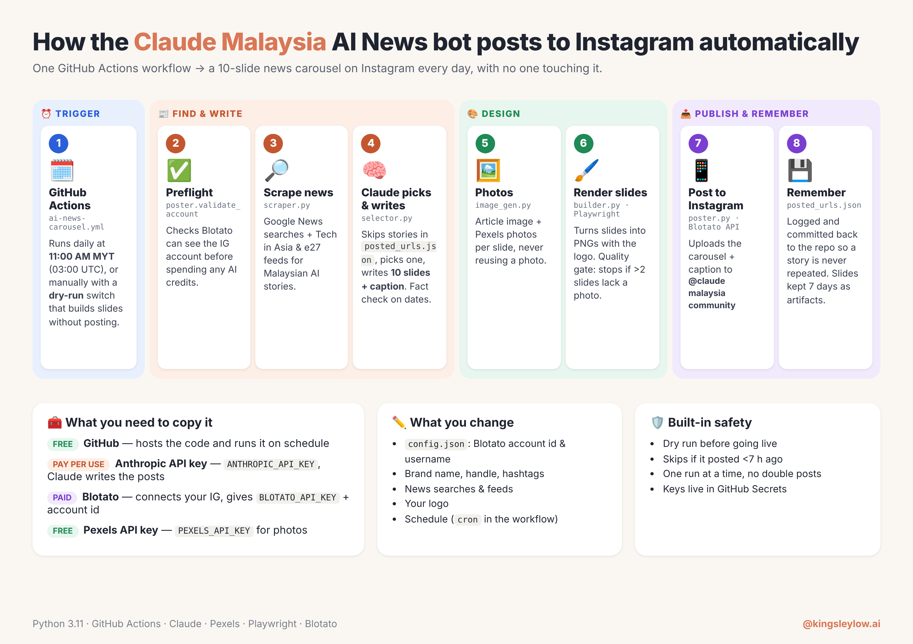

# Daily AI news Instagram carousel

This is a template. Click **Use this template**, add three secrets, edit `config.json`, replace the logo, and a GitHub Action will build a 10-slide AI-news carousel and post it to your Instagram every day.



The picture is the daily flow. The handle and brand painted on that sample are illustrations. Your slides use the brand name, handle, comment keyword, and logo you set in step 4. A printable copy of the same picture is in [docs/how-it-works.pdf](docs/how-it-works.pdf).

One workflow does the whole job:

1. It checks that Blotato can see your Instagram account.
2. It scrapes Google News plus tech sites for AI stories.
3. Claude scores the stories, skips anything already in `posted_urls.json`, and writes 10 slides and a caption.
4. Pexels supplies a photo for each slide. The bot will not reuse a photo it has already used.
5. Playwright renders the slides with your logo. If more than two slides have no photo, a live post is blocked.
6. Blotato uploads the carousel to Instagram.
7. The story URL is appended to `posted_urls.json` and committed back, so the same story is not posted again.

A run also refuses to post if the last successful post was less than 7 hours ago.

## What it costs

| Service | What you pay |
| --- | --- |
| GitHub Actions | Free on the public GitHub plan (this template runs one job a day). |
| Pexels | Free API key. |
| Anthropic | Pay per use. Scoring uses Claude Haiku and the carousel text uses Claude Sonnet. A quiet day is usually well under a dollar, and a busy month is often a few dollars. |
| Blotato | Paid. This is the service that connects your Instagram account and publishes the carousel. |

You do not put API keys in the code. The workflow reads `ANTHROPIC_API_KEY`, `BLOTATO_API_KEY`, and `PEXELS_API_KEY` from GitHub Actions secrets.

## Setup

### 1. Create your own copy

On this repository, click **Use this template**, then **Create a new repository**. Leave it public unless you have GitHub Actions minutes on a private repo. The new repository is yours. The schedule will not publish anything until you finish the steps below.

### 2. Create the three accounts and copy the keys

- [Anthropic console](https://console.anthropic.com/) — create an API key. You need a paid credit balance before Claude will answer.
- [Blotato](https://www.blotato.com/) — create an account, connect the Instagram account you want to post from, then copy the API key and the Instagram account id. The id is a number Blotato assigns to that connected account. It is not your Instagram username.
- [Pexels API](https://www.pexels.com/api/) — request a free API key.

### 3. Add the three secrets

In your new repository open **Settings → Secrets and variables → Actions → New repository secret**. Create these three, with those exact names:

- `ANTHROPIC_API_KEY`
- `BLOTATO_API_KEY`
- `PEXELS_API_KEY`

### 4. Edit `config.json` and replace the logo

Open `config.json` and replace every value that contains `YOUR_`:

- `blotato.instagram_account_id` — the numeric Blotato id from step 2. The template ships as `YOUR_BLOTATO_INSTAGRAM_ACCOUNT_ID`.
- `blotato.instagram_username` — the Instagram username, without the `@`.
- `account_handle`, `community_name`, `community_url`, and `comment_keyword` — how the slides and caption name you, and the word people comment to join.
- `posting.hashtags` — up to five hashtags. The poster keeps only the first five.
- `google_news_queries` — the Google News searches. The Malaysia queries in the file are examples. Change the country, city, currency, landmarks, and government names in the same file if you cover somewhere else.

Replace `logo.png` with a square image of your own logo. A simple PNG or the existing filename is enough. The circle that says LOGO is only a placeholder.

### 5. Let Actions write back to the repository

Open **Settings → Actions → General → Workflow permissions** and choose **Read and write permissions**. Save.

The workflow already requests `contents: write`. That setting is what allows a fresh copy to commit `posted_urls.json` after a real post. Without it, the post can succeed and the next day will not remember it.

### 6. Dry run

Open **Actions → AI News Carousel → Run workflow**. Tick **Dry run** and run it.

A dry run builds the slides and uploads them as an artifact. It does not call Instagram. When the run finishes, open it, scroll to **Artifacts**, and download `carousel-slides-...`. You should see ten PNGs plus `review_manifest.json` (the story, the caption, and where each photo came from).

The first dry run fails on purpose if `config.json` still contains `YOUR_` placeholders. The log tells you which fields to edit. Fill those in and run it again.

### 7. Go live

Run **AI News Carousel** again and leave **Dry run** unticked. Or wait for the schedule. After a real post, the Action commits `posted_urls.json` so that URL is not used again.

You can also run **Preflight** any time. It only checks that the Blotato key works and that the account id in `config.json` is an Instagram account connected to that key.

## Change the posting time

The schedule is in `.github/workflows/ai-news-carousel.yml`:

```yaml
- cron: '0 3 * * *'
```

GitHub cron is always **UTC**, not your local time. `0 3 * * *` means minute 0 of hour 3, every day: **03:00 UTC**. That is 11:00 in Malaysia (UTC+8).

Edit the first number for the minute and the second number for the hour. `30 15 * * *` is 15:30 UTC. The workflow file has a short comment next to the line. After you commit the change, the next run uses the new time. GitHub can start a scheduled job a few minutes late when Actions is busy.

## Troubleshooting

**The workflow failed immediately and the log talks about placeholders.** `config.json` still has `YOUR_` text, or the account id is not a number. Edit the fields named in the log. A scheduled run on a fresh copy does not fail all night: it skips live posting until the account id is set.

**Preflight failed.** The usual cause is the wrong Blotato account id. The log lists the Instagram accounts that key can actually see, in the form `12345 (@yourname)`. Copy that number into `blotato.instagram_account_id` and the username into `blotato.instagram_username`. A mismatch between the id and the username fails the same way. An empty `BLOTATO_API_KEY` or `ANTHROPIC_API_KEY` fails here too.

**Dry run slides are plain dark gradients, or a live run says the visual quality gate blocked publication.** `PEXELS_API_KEY` is missing or rejected, so the bot could not download photos. A live post stops when more than two of the ten slides have no photo. Fix the secret and dry-run again.

**The run posted, but `posted_urls.json` did not change.** Workflow permissions are still read-only. Repeat step 5, then run once more. Until that file updates, a later run can pick the same story.

**It posted, then the next manual run did nothing.** The bot skips a live post when the last one was less than 7 hours ago. A dry run still builds slides during that window.

**The Action cannot find Python dependencies or Chromium.** Leave the workflow's "Install dependencies" step as it is. It installs `requirements.txt` and Playwright's Chromium on every run. You do not install those on your own computer unless you want to run `python pipeline.py --dry-run` locally.

## Run it on your own computer

```bash
python -m venv .venv
source .venv/bin/activate
pip install -r requirements.txt
playwright install chromium
export ANTHROPIC_API_KEY=...
export BLOTATO_API_KEY=...
export PEXELS_API_KEY=...
python pipeline.py --dry-run
```

Slides land in `~/Downloads/carousels/`. `--dry-run` skips Instagram. Omit it only when `config.json` has your real account id and you want a live post.
